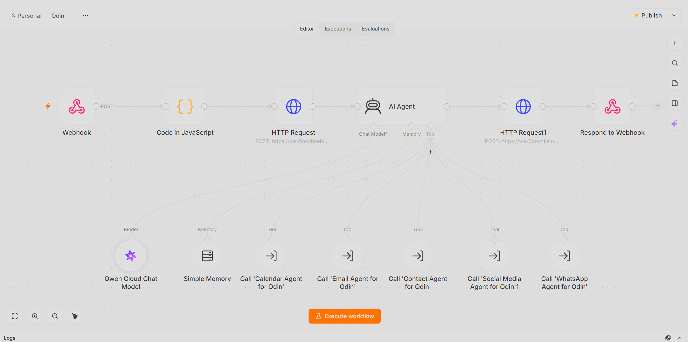
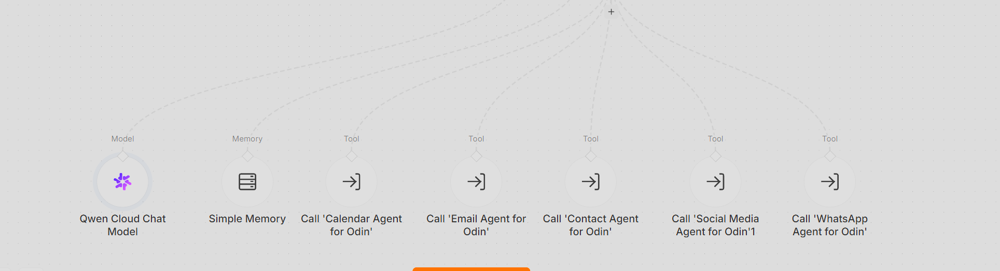
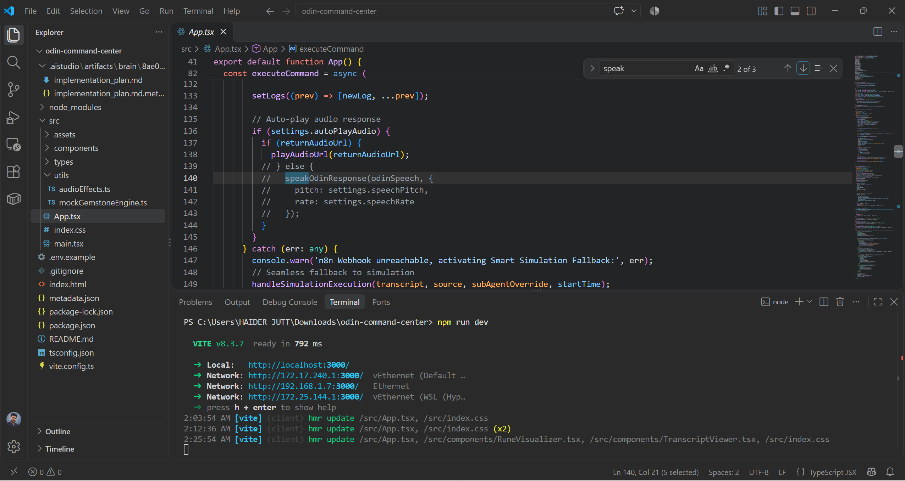
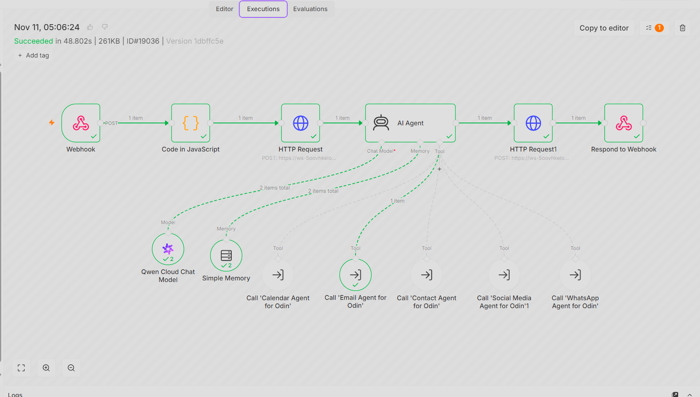

# 🎙️ Odin: Enterprise Voice AI Command Center

A full-stack, real-time Voice AI Executive Assistant designed to orchestrate complex business operations through natural voice commands. Odin bridges a custom **React/TypeScript** frontend dashboard with a powerful **self-hosted n8n Multi-Agent Backend running on local Docker**, utilizing **Alibaba Cloud's Qwen LLM** and high-fidelity Text-to-Speech (TTS) for natural Urdu and Roman Urdu interactions.

---

## 🌟 Executive Summary
Unlike standard text-based chatbots, Odin is a fully autonomous "Digital Employee." It captures user voice input via a custom Push-to-Talk (PTT) React interface, processes the intent through an LLM, and delegates operational tasks to **5 specialized sub-agents**. The system then generates a hyper-realistic voice response and dynamically auto-plays it on the frontend dashboard without requiring manual intervention. All backend data processing and API routing are securely handled within a local Dockerized infrastructure.

---

## 📂 Repository Structure & Architecture Visuals

The project is modularized into dedicated frontend, backend, and documentation directories:

    odin-voice-ai-command-center/
    ├── frontend-dashboard/                     # Custom React UI
    │   ├── App.tsx                             # Core UI, Webhook integration & audio execution
    │   ├── audioEffects.ts                     # TTS fallback suppression logic
    │   └── package.json                        # Frontend dependencies
    ├── n8n-workflows/                          # Backend Orchestration & Agents
    │   ├── odin-main-orchestrator.json         # Core Qwen LLM Brain & Webhook handler
    │   ├── sub-agent-calendar-manager.json     # Google Calendar operations
    │   ├── sub-agent-crm-contacts.json         # Airtable CRM integration
    │   ├── sub-agent-email-handler.json        # Gmail inbox & drafting operations
    │   ├── sub-agent-social-media.json         # Facebook/Instagram content manager
    │   └── sub-agent-whatsapp.json             # WhatsApp Cloud API integration
    └── screenshots/                            # Visual architecture & execution proofs

---

## 🖼️ Project Screenshots & UI Previews

### 1. React Frontend Command Center UI
*Scrollable view of the custom React dashboard interface:*

### 2. n8n Core Architecture
*Main n8n orchestration canvas showing Webhook, Qwen LLM, and Alibaba TTS nodes:*

### 3. Operational Sub-Agents Layout
*Visual layout of the 5 connected operational sub-agents (Calendar, CRM, Email, Social Media, WhatsApp):*

### 4. VS Code Custom React Code
*VS Code snippet proving custom audio handling and English TTS fallback disable:*

### 5. Live Payload Execution
*Proof of successful dynamic JSON payload execution and auto-play delivery:*

---

## 🏗️ Core Architecture & Tech Stack

### 1. Frontend (Command Center UI)
- **Framework:** React 18, Vite, TypeScript
- **Audio Handling:** HTML5 Web Audio API, Auto-play policy bypass, Dynamic Audio URL mapping.
- **Features:** Real-time chat log rendering, Custom Norse acoustic chimes, Voice Activity Detection (VAD) / Push-to-Talk (PTT).

### 2. Backend (n8n Orchestration via Docker)
- **Engine:** n8n (Self-Hosted via Docker Desktop on Local Environment for maximum privacy and zero-latency execution)
- **Memory:** Simple Memory Buffer for conversational context.
- **Webhooks:** RESTful POST endpoints handling bi-directional JSON payloads and binary audio transfers between the local Docker container and the React frontend.

### 3. AI & Voice Models
- **Brain / LLM:** Alibaba Cloud Qwen Chat Model.
- **Voice Synthesis (TTS):** Alibaba DashScope `qwen-audio-3.1-tts-next` (Configured with `longcheng` voice profile, 0.80 cadence, and 16000 sample rate).

---

## 🤖 The 5 Operational Sub-Agents
Odin delegates tasks to specific micro-agents *(See `n8n-workflows/`)*:

1. 📅 **Calendar Agent:** Audits schedules, checks availability, and books real-time meetings.
2. ✉️ **Email Agent:** Drafts, reviews, and dispatches contextual emails.
3. 👥 **Contact Agent:** Syncs with Airtable databases to fetch customer details and lead data.
4. 📱 **Social Media Agent:** Manages social platform updates and content scheduling.
5. 💬 **WhatsApp Agent:** Triggers direct automated messages and handles customer communication flows.

---

## 👨‍💻 Technical Challenges Solved (Engineering Highlights)

- **Secure Local Deployment:** By hosting the entire n8n orchestration engine locally via Docker, all sensitive API keys (Google Calendar, Airtable CRM, Gmail) remain completely isolated from third-party SaaS environments, ensuring enterprise-grade data privacy.
- **React "White Screen of Death" Resolution:** Prevented React UI crashes from nested AI output objects by implementing strict payload serialization (`JSON.stringify()`) inside the webhook response body, ensuring the frontend only received safe strings.
- **Bypassing Local Speech Synthesis:** Suppressed the browser's native robotic English fallback voice by refactoring `audioEffects.ts` with early `return;` statements, forcing the dashboard to exclusively play the high-fidelity server-side WAV URL.
- **Binary File to JSON Pipeline Conversion:** Reconfigured the n8n HTTP Request node's response format from 'File' to 'JSON' to successfully extract the dynamic Alibaba TTS audio URL from the binary response.

---
*Architected and Developed by **Abu Bakar Siddique** (@hafiz-abubakar-dev) — AI Automation Engineer*
